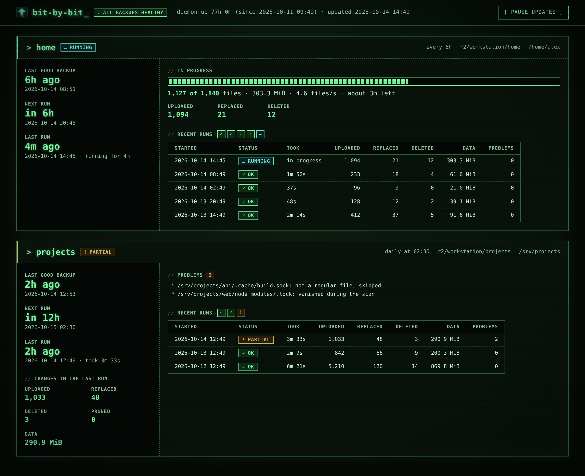

# bit-by-bit

Incremental backups of a Linux machine to S3-compatible object storage (AWS S3,
Google Cloud Storage, Cloudflare R2, Backblaze B2, MinIO, Wasabi), run as a
systemd service. Written in [Ecko](https://ecko.sh).



- Each local file becomes one object, and only changed files are uploaded.
- Before a remote file is overwritten or deleted, the old copy is moved under
  `_versions/`, so local mistakes can be undone. Old versions are pruned after
  `keep_versions_days`.
- Uploads are checked by the provider against a SHA-256 of the content. A
  crash at any point leaves the backup consistent, and the next run finishes
  the work.
- A missing or unreadable directory never causes remote deletes, and neither
  does a directory that has suddenly become empty although files were backed
  up from it (an unmounted drive).
- Changing a job's destination or prefix triggers a full upload to the new
  place.
- Server-side encryption is on by default, and every request goes over HTTPS.

## Install

Each [release](https://github.com/sn/bit-by-bit/releases) has a prebuilt
binary for x86-64 and arm64 Linux, with a `.sha256` beside it. No Ecko needed:

```bash
v=v0.5.0 arch=x86_64   # or aarch64
f=bit-by-bit-$v-$arch-linux.tar.gz
curl -fsSLO https://github.com/sn/bit-by-bit/releases/download/$v/$f
curl -fsSLO https://github.com/sn/bit-by-bit/releases/download/$v/$f.sha256
sha256sum -c $f.sha256 && tar -xzf $f && cd bit-by-bit-$v-$arch-linux
sudo ./deploy/install.sh
```

To build from source instead, you need Ecko 0.66 or later. The one
dependency, the [`xml`](https://github.com/ecko-lang/xml) package, is vendored
in `vendor/` and pinned in `ecko.lock`; `ecko install` restores it if it's
missing.

```bash
ecko build main.ecko -o bit-by-bit
sudo ./deploy/install.sh
```

The installer puts the binary in `/usr/local/bin` and an example config in
`/etc/bit-by-bit/config.json`, and registers the systemd unit. It does not
enable the service. Then:

```bash
sudoedit /etc/bit-by-bit/config.json
sudo bit-by-bit check-config
sudo bit-by-bit run --dry-run
sudo bit-by-bit run                    # first full upload, in the foreground
sudo systemctl enable --now bit-by-bit
```

`check-config` only reads the file. The first real `run` is what proves the
credentials, bucket and region.

## Run as a service

`sudo systemctl enable --now bit-by-bit` starts the daemon now and at every
boot. It runs as root, can write only to `/var/lib/bit-by-bit` and
`/var/log/bit-by-bit`, and restarts every 30 seconds if it exits, so a broken
config shows up as repeated errors in the journal, not as a stopped service.

| To | Run |
|---|---|
| Check it | `systemctl status bit-by-bit`, `sudo bit-by-bit status` |
| Follow the log | `journalctl -u bit-by-bit -f` (also written to `/var/log/bit-by-bit/bit-by-bit.log`) |
| Apply config changes | `sudo systemctl reload bit-by-bit` |
| Back up now | `sudo bit-by-bit run home`. A run holds `job-<name>.lock` in `state_dir`, so it never overlaps the daemon's run of the same job, and a daemon that restarts meanwhile leaves it running. |
| Stop it | `sudo systemctl stop bit-by-bit`. Uploads already started finish; nothing new starts. It waits up to 60 seconds. |
| Turn it off | `sudo systemctl disable --now bit-by-bit` |

## Configure

See `deploy/config.example.json`. The full field reference is in
`docs/superpowers/specs/2026-10-12-bit-by-bit-design.md`, section 3.

- **Schedules:** `{ "every": "6h" }` (minimum `1m`) or
  `{ "daily_at": "02:30" }` (local time, following daylight-saving changes).
  A run missed while the machine was off happens once at startup. A run that
  fails, or is cut short by a restart, is retried 15 minutes after it ended,
  then after 30, 60 and so on, never waiting longer than the job's interval.
- **Credentials:** a `KEY=value` file, mode 600:

  ```
  ACCESS_KEY_ID=...
  SECRET_ACCESS_KEY=...
  ```

  Alternatively set `BBB_<DEST>_ACCESS_KEY_ID` and
  `BBB_<DEST>_SECRET_ACCESS_KEY` in the environment, where `<DEST>` is the
  destination name upper-cased with `-` replaced by `_`.
- **Reload:** `systemctl reload bit-by-bit` sends SIGHUP. An invalid config is
  rejected and the old one stays active.
- **Excludes remove files from the backup.** A file that newly matches
  `exclude` is treated like a deleted file: its remote copy moves to
  `_versions/` and is pruned after `keep_versions_days`.
- **Several jobs can share a prefix,** such as one per folder of the same
  machine, as long as their `paths` don't overlap. Each job only rebuilds,
  prunes, lists and restores its own files. Nested prefixes (`pc` and `pc/docs`)
  are refused, because two jobs could then write the same object.
- **Changing `prefix` or the destination** uploads everything to the new place.
  Objects under the old prefix are left alone; delete them yourself if you no
  longer want them.
- **Concurrency:** `concurrency` workers (default 4, up to 128) each take the
  next file as soon as they finish one, so a large file holds up only its own
  worker. Small files are limited by round trips to the provider, not by
  bandwidth: at 150 ms per request, 16 workers upload about 100 files a
  second, 64 about 370 and 128 about 530. Use 32-64 for a distant region.
  Large files go up in parts, 4 at a time, streamed from disk; no file is
  held in memory. The scan before the uploads also runs in parallel for
  large trees (except with `follow_symlinks`). `ls`, `restore` and
  `--rebuild-state` use the same number of workers.
- **Symlinks** are backed up as links, not followed (unless `follow_symlinks`
  is set), and keep their target exactly as written: a relative link restores
  relative. A link whose target is missing is backed up too.
- **Permissions:** a change of mode alone (`chmod`) is backed up by updating
  the object's metadata, without uploading the file again.
- **Problems:** a run counts every problem, and keeps the text of the first
  1,000 for `status` and the dashboard. The log has all of them.

### AWS S3 setup

Give the daemon its own IAM user whose policy covers only the backup bucket:

```json
{
  "Version": "2012-10-17",
  "Statement": [
    { "Effect": "Allow", "Action": "s3:ListBucket",
      "Resource": "arn:aws:s3:::BUCKET" },
    { "Effect": "Allow",
      "Action": ["s3:GetObject", "s3:PutObject", "s3:DeleteObject", "s3:AbortMultipartUpload"],
      "Resource": "arn:aws:s3:::BUCKET/*" }
  ]
}
```

```bash
aws iam create-user --user-name bit-by-bit
aws iam put-user-policy --user-name bit-by-bit --policy-name bit-by-bit-s3 \
  --policy-document file://policy.json
aws iam create-access-key --user-name bit-by-bit \
  --query 'AccessKey.[AccessKeyId,SecretAccessKey]' --output text |
  awk '{print "ACCESS_KEY_ID=" $1 "\nSECRET_ACCESS_KEY=" $2}' |
  sudo install -D -m 0600 /dev/stdin /etc/bit-by-bit/aws.env
```

The secret goes straight into the credentials file without being printed.

- **The region must be the bucket's region**, in both `endpoint` and
  `region`. A mismatch fails the run with `301 PermanentRedirect`.
- **Bucket versioning is optional.** If it's on, keep it: the policy has no
  `s3:DeleteObjectVersion`, so a leaked key can hide objects but not destroy
  them. Add a lifecycle rule, or every copy bit-by-bit prunes stays stored
  (and billed) forever:

  ```bash
  aws s3api put-bucket-lifecycle-configuration --bucket BUCKET --lifecycle-configuration \
    '{"Rules":[{"ID":"bit-by-bit-cleanup","Status":"Enabled","Filter":{},
      "NoncurrentVersionExpiration":{"NoncurrentDays":90},
      "AbortIncompleteMultipartUpload":{"DaysAfterInitiation":7},
      "Expiration":{"ExpiredObjectDeleteMarker":true}}]}'
  ```

- To rotate the key, create a second one, rewrite the credentials file,
  `systemctl reload bit-by-bit`, then delete the old key.

### Providers

| Provider | Destination settings |
|---|---|
| AWS S3 | `"provider": "s3"`, `"endpoint": "https://s3.<region>.amazonaws.com"`, `"region": "<region>"` |
| Google Cloud Storage | `"provider": "gcs"`. Create HMAC keys for a service account (Cloud Storage > Settings > Interoperability) and put them in the credentials file. |
| Cloudflare R2 | `"provider": "s3"`, `"endpoint": "https://<account-id>.r2.cloudflarestorage.com"`, `"region": "auto"` |
| Backblaze B2 | `"provider": "s3"`, `"endpoint": "https://s3.<region>.backblazeb2.com"`, `"region": "<region>"` |
| MinIO (local) | `"provider": "s3"`, `"endpoint": "http://127.0.0.1:9000"`, `"region": "us-east-1"`, `"path_style": true`, `"allow_insecure": true`, `"server_side_encryption": false` (MinIO without a KMS rejects SSE requests) |

## Use

```bash
bit-by-bit status                      # last run, next run and problems for each job
bit-by-bit run home                    # run a job now (exit 0 ok, 2 partial, 1 failed)
bit-by-bit ls home --at 2026-10-01T12:00:00Z
bit-by-bit restore home --path /home/me/Documents --to /tmp/restore
bit-by-bit restore home --at 2026-10-01T12:00:00Z
journalctl -u bit-by-bit -p warning    # problems and failures
```

Restore never overwrites existing files unless you pass `--overwrite`. It
checks every file against its stored fingerprint, and puts back each file's
mode and modification time. Files download several at a time; symlinks are
created after every file, and nothing is ever written through a symlink, so a
tampered bucket can't make a restore write outside `--to`.

**Not backed up:** file owner and group (restored files belong to the user
running the restore; Ecko has no way yet to read or set ownership), empty
directories, and directory permissions. Hard links are uploaded once per
name.

## State

bit-by-bit remembers what it has uploaded in the SQLite file
`<state_dir>/state.db` (`/var/lib/bit-by-bit/state.db` by default). A file
whose size and mtime match its row there is not uploaded again, and the bucket
is not checked for it.

**So don't delete or change objects in the bucket by hand.** Anything removed
behind bit-by-bit's back stays missing until the local file changes. If the
bucket and the database disagree, or the database is lost, rebuild it from
the bucket:

```bash
sudo bit-by-bit run home --rebuild-state   # only rebuilds the database, uploads nothing
sudo bit-by-bit run home                   # uploads whatever the bucket is missing
```

## Dashboard

The daemon can serve a read-only status page. It's off unless the config has:

```json
"dashboard": { "listen": "127.0.0.1:8484" }
```

| URL | What |
|---|---|
| `http://127.0.0.1:8484/` | Each job's status, live progress of a running backup (files done of planned, data, files/s and time left, saved about once a second), how long ago its last good backup finished, when it runs next, its schedule and destination, the last run's changes, errors, problems and recent runs. Full-width, styled like a green-phosphor CRT terminal (scanlines and glow drop away when the system asks for more contrast). The tab icon, an upload arrow whose shaft breaks into bits, glows cyan to violet when every backup is healthy and orange to red when one needs attention. Updates in place every 3 seconds while a backup runs and every 30 seconds otherwise (keeping your scroll position, focus and open lists) while the tab is visible; "Pause updates" stops it. Without JavaScript, reload by hand. |
| `/api/status` | The same data as JSON. |
| `/healthz` | `200 ok`, or `503` listing why: a job's last run failed, or it hasn't run for more than twice its interval. Point an uptime monitor at it. |

The page has no login, so it only binds to loopback addresses (`127.0.0.1`,
`localhost`, `::1`). To reach it from elsewhere, use an SSH tunnel
(`ssh -L 8484:127.0.0.1:8484 host`), or set `"allow_remote": true` deliberately.
The page's only control pauses its updates; it can't change anything. If the port is taken, the
daemon logs an error and keeps backing up. Changing `listen` needs a service
restart.

## Remote layout

```
<prefix>/<absolute local path>                       current copy
<prefix>/_versions/<run time>/<absolute local path>  copy moved aside by that run
```

Objects carry `x-amz-meta-bbb-sha256`, `-mtime`, `-mode` and `-run`. Symlinks
are stored as empty objects with `x-amz-meta-bbb-symlink`.

`bbb-sha256` is the content's SHA-256 for a file uploaded in one request. A
file uploaded in parts (at least `multipart_threshold`, 64 MiB by default)
has `mp<part size>-<SHA-256 of its parts' hex SHA-256s, joined>` instead:
its parts are hashed in one read and each is sent with its hash, so the
provider refuses any part that changed in between.

## Develop

```bash
ecko test --jobs 4                # every test file, each in its own process
ecko test tests/sync_test.ecko
ecko check --strict main.ecko src/*.ecko tests/*.ecko testkit/*.ecko
```

Tests run offline against `testkit/fake_s3.ecko`, an in-memory S3 server that
checks signatures, payload hashes and `content-length` (S3 refuses a PUT or
POST without one, even an empty one) and can be told to fail requests.

## Release

Publish a GitHub release with a tag such as `v0.6.0`. The release workflow
runs the checks and tests, builds on native x86-64 and arm64 Linux runners
with the Ecko version pinned in `.github/workflows/release.yml`, and attaches
`bit-by-bit-<tag>-<arch>-linux.tar.gz` and its `.sha256` to the release.

## License

MIT. Copyright (c) 2026 Sean Nieuwoudt. See [LICENSE](LICENSE).
